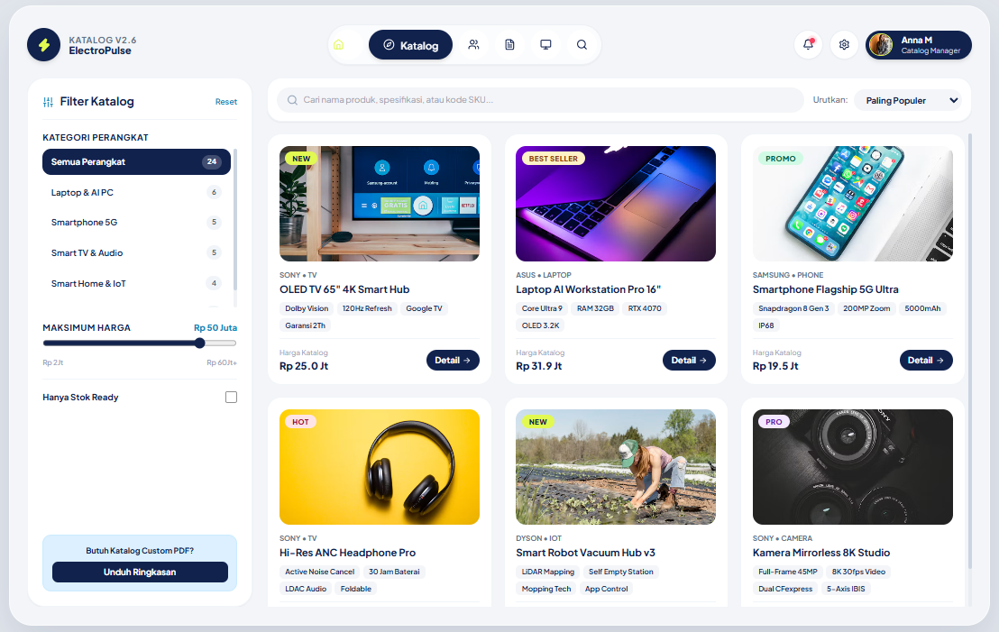

# ElectroPulse — E-Catalog Elektronik

Website katalog elektronik statis dengan enam menu: Beranda, Katalog, Brand & Mitra, Spesifikasi, Bundling, dan Pencarian. Dibuat dengan HTML, CSS, dan JavaScript tanpa proses build.



## Fitur

- Filter gabungan kategori, pencarian nama/brand/spesifikasi/SKU, batas harga, stok, pengurutan, dan reset.
- Detail produk, komparasi dua perangkat, kalkulator bundling, dan presentasi showroom.
- Penambahan produk sementara dengan validasi nama, harga, kategori, dan spesifikasi.
- Navigasi keyboard, fokus dialog, Escape untuk menutup dialog, dan dukungan reduced motion.
- Cetak melalui dialog browser; pilih **Save as PDF / Simpan sebagai PDF** untuk menyimpan halaman aktif.

## Menjalankan

Buka `index.html` langsung di browser, atau gunakan server lokal dari direktori proyek:

```sh
python -m http.server 8000
```

Buka `http://localhost:8000`. Internet diperlukan untuk Tailwind CDN, Lucide, Google Fonts, dan gambar Unsplash. Tidak perlu `npm install`.

## Struktur

```text
.
├── index.html                     # Struktur halaman dan enam menu
├── css/
│   └── styles.css                 # Responsivitas, fokus, dan cetak
├── js/
│   ├── data.js                    # Data produk dan slide showroom
│   ├── app.js                     # Interaksi, validasi, dialog, dan rendering
│   ├── filter.js                  # Logika filter katalog (fungsi murni)
│   └── tailwind.config.js         # Warna, font, dan animasi tema
├── assets/
│   └── screenshot.png             # Pratinjau proyek
├── tests/
│   └── filter.test.js             # Pemeriksaan filter dengan Node.js
└── .github/
    └── workflows/
        └── pages.yml              # Deployment GitHub Pages
```

## Kustomisasi

- Edit `js/data.js` untuk produk dan showroom. Gunakan ID SKU unik berisi huruf, angka, dan tanda hubung; `price`/`stock` berupa angka, `specs` berupa array teks. URL gambar harus HTTPS tepercaya.
- Kategori yang tersedia: `laptop`, `phone`, `tv`, `iot`, dan `camera`.
- Ubah palet dan font di `js/tailwind.config.js`, tata letak di `css/styles.css`, serta teks statis di `index.html`.
- Nama baru dibatasi 120 karakter; harga bilangan bulat Rp 1–1 miliar; 1–10 spesifikasi dipisahkan koma, maksimal 100 karakter per item dan 500 karakter total.
- Ganti `assets/screenshot.png` dengan tangkapan layar baru jika tampilan diubah.

## Deployment GitHub Pages

1. Unggah isi direktori proyek ini sebagai root repository GitHub.
2. Buka **Settings → Pages → Build and deployment → Source: GitHub Actions**.
3. Push ke branch `main`, atau jalankan workflow **Deploy static site to Pages** dari tab Actions.
4. Setelah deployment selesai, buka URL yang ditampilkan pada environment `github-pages`.

Workflow hanya menerbitkan `index.html`, `css`, `js`, dan `assets`. Semua referensi lokal memakai path relatif agar berjalan pada URL project Pages. Jika branch utama berbeda, sesuaikan `branches` di workflow.

## Pemeriksaan

Dengan Node.js tersedia:

```sh
node tests/filter.test.js
```

Periksa keenam menu pada desktop dan lebar 320/375/768 px; gabungkan semua filter dan reset; cari berdasarkan spesifikasi serta SKU. Coba input kosong, harga negatif, dan teks `` sebagai nama: teks harus ditampilkan biasa. Uji Tab/Shift+Tab/Escape di dialog, pemulihan fokus, serta pratinjau cetak katalog dan komparasi.

## Batasan

Ini demo frontend, bukan sistem inventaris produksi. Harga, stok, statistik, promo, mitra, garansi, dan akun merupakan contoh, bukan penawaran resmi. Tambahan produk hanya ada di memori halaman dan hilang saat refresh; tidak ada database, login, transaksi, pengiriman email, sinkronisasi arsip, atau notifikasi real-time. Tombol yang memerlukan backend menampilkan pesan demo, bukan klaim pengiriman berhasil. Urutan “Paling Populer” mengikuti urutan data, bukan analitik penjualan. Filter harga bawaan maksimum Rp 50 juta.

PDF menggunakan fasilitas cetak browser, bukan generator dokumen server. Dependensi CDN dan gambar eksternal memerlukan koneksi internet; untuk produksi, gunakan aset lokal dan build Tailwind sesuai kebutuhan deployment.
